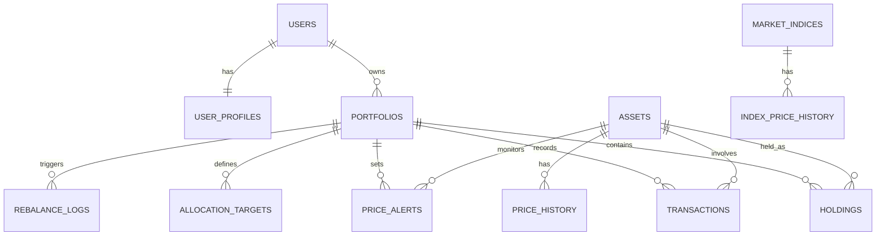
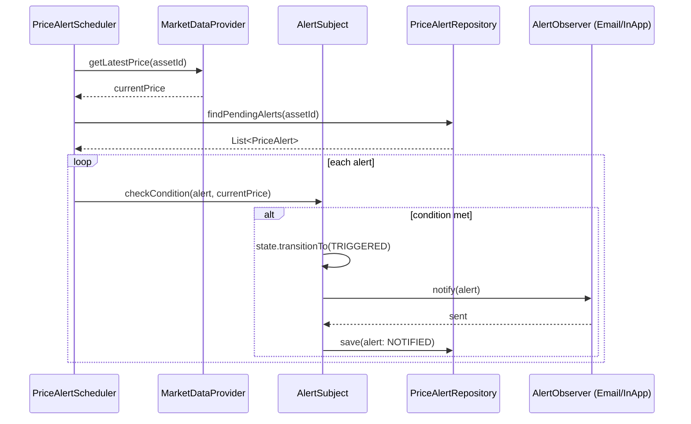
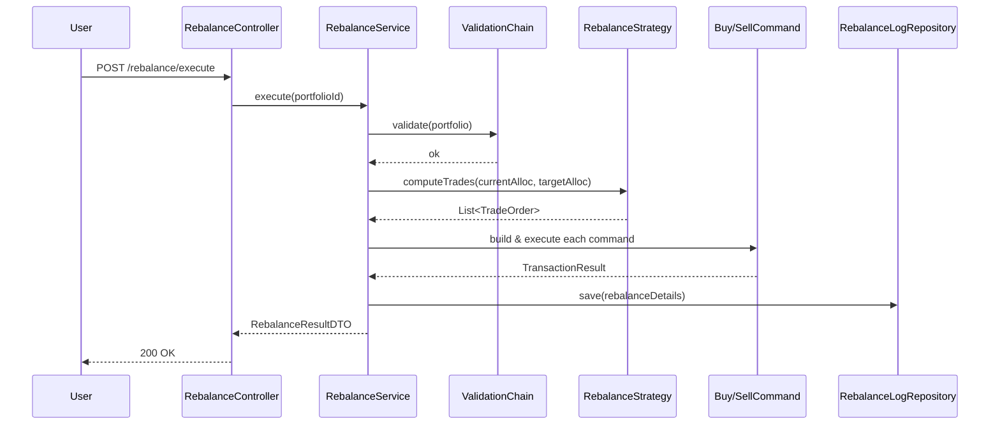

# ระบบจัดการพอร์ตการลงทุน (Investment Portfolio Management System)
### CP353002 — Spring Boot Project | โครงสร้างระบบแบบละเอียด

ฟีเจอร์หลัก 5 ข้อ: **Asset Allocation**, **Support/Resistance**, **Price Alert**, **Growth vs Market Comparison**, **Rebalancing**

---

## 1. ภาพรวมสถาปัตยกรรม (Layered Architecture)

```
Presentation Layer   → RestController (api/) + Thymeleaf/React (web/)
        ↓
Service Layer        → Business Logic, Strategy, Transaction (@Transactional)
        ↓
Repository Layer     → Spring Data JPA
        ↓
Domain / Entity Layer → Entity, Enum, Value Object
        + DTO Layer (Request/Response + Mapper)
        + Config / Exception / Scheduler / Common
```

**กฎเหล็ก:** Controller ห้ามเรียก Repository ตรง ๆ, Service ต้องขึ้นกับ Interface เท่านั้น (DIP)

---

## 2. โครงสร้าง Package

```
com.example.portfolio
├── config/
│   ├── SwaggerConfig.java
│   ├── SecurityConfig.java
│   └── SchedulingConfig.java
├── controller/
│   ├── api/
│   │   ├── PortfolioController.java
│   │   ├── HoldingController.java
│   │   ├── AssetController.java
│   │   ├── AllocationController.java        # ฟีเจอร์ 1
│   │   ├── PriceAnalysisController.java     # ฟีเจอร์ 2 (support/resistance)
│   │   ├── PriceAlertController.java        # ฟีเจอร์ 3
│   │   ├── PerformanceController.java       # ฟีเจอร์ 4 (growth vs market)
│   │   └── RebalanceController.java         # ฟีเจอร์ 5
│   └── web/                                  # (ถ้าใช้ Thymeleaf)
├── service/
│   ├── PortfolioService.java / impl/
│   ├── HoldingService.java / impl/
│   ├── allocation/
│   │   ├── AllocationStrategy.java              (interface)
│   │   ├── EqualWeightAllocationStrategy.java
│   │   ├── TargetPercentageAllocationStrategy.java
│   │   └── RiskBasedAllocationStrategy.java
│   ├── analysis/
│   │   ├── SupportResistanceStrategy.java       (interface)
│   │   ├── PivotPointCalculator.java
│   │   └── MovingAverageBandCalculator.java
│   ├── alert/
│   │   ├── AlertObserver.java                   (interface)
│   │   ├── EmailAlertNotifier.java
│   │   ├── InAppAlertNotifier.java
│   │   ├── AlertSubject.java                    (Observer subject)
│   │   └── AlertState.java + PendingState/TriggeredState/ExpiredState
│   ├── performance/
│   │   ├── PerformanceReportTemplate.java       (abstract, Template Method)
│   │   └── BenchmarkComparisonService.java
│   ├── rebalance/
│   │   ├── RebalanceStrategy.java               (interface)
│   │   ├── ThresholdRebalanceStrategy.java
│   │   ├── CalendarRebalanceStrategy.java
│   │   ├── RebalanceCommand.java                (interface, Command)
│   │   ├── BuyCommand.java / SellCommand.java
│   │   └── RebalanceValidationHandler.java      (Chain of Responsibility)
│   └── market/
│       ├── MarketDataProvider.java              (interface)
│       └── adapter/ExternalMarketDataAdapter.java  (Adapter → 3rd-party API)
├── repository/
│   └── *Repository.java  (interfaces extends JpaRepository)
├── domain/
│   ├── entity/
│   └── enums/
│       ├── AssetType.java        (STOCK, ETF, BOND, MUTUAL_FUND, CRYPTO, CASH)
│       ├── TransactionType.java  (BUY, SELL, DIVIDEND, DEPOSIT, WITHDRAWAL)
│       ├── AlertCondition.java   (PRICE_ABOVE, PRICE_BELOW, PCT_CHANGE)
│       ├── AlertStatus.java      (PENDING, TRIGGERED, NOTIFIED, EXPIRED, CANCELLED)
│       └── RebalanceMethod.java  (THRESHOLD, CALENDAR)
├── dto/
│   ├── request/
│   └── response/
├── mapper/          # MapStruct หรือ manual mapper
├── exception/
│   ├── GlobalExceptionHandler.java  (@RestControllerAdvice)
│   └── *NotFoundException.java, InvalidRebalanceException.java
├── scheduler/
│   └── PriceAlertScheduler.java     (@Scheduled ตรวจราคาเป็นระยะ)
└── common/
```

---

## 3. การแมป SOLID (สำหรับ doc/solid-analysis.md)

| หลักการ | วิธีใช้ในระบบนี้ |
|---|---|
| **SRP** | แยก `AllocationService`, `AlertService`, `RebalanceService`, `PerformanceService` ออกจากกันชัดเจน แต่ละคลาสทำหน้าที่เดียว |
| **OCP** | เพิ่มกลยุทธ์ rebalance/allocation ใหม่ = เพิ่มคลาส implement interface โดยไม่แก้โค้ดเดิม (`RebalanceStrategy`, `AllocationStrategy`) |
| **LSP** | ทุก `*Strategy` implementation ใช้แทนกันได้ผ่าน interface เดียวกันโดยไม่พังตรรกะ |
| **ISP** | แยก `AlertObserver` ออกจาก `AlertRepository` และ `NotificationSender` ไม่รวมเป็น interface เดียว |
| **DIP** | Service ทุกตัว inject ผ่าน constructor และขึ้นกับ interface (`MarketDataProvider`, ไม่ผูกกับ implementation ของ API ภายนอก) |

---

## 4. Design Patterns

### 4.1 Enterprise Patterns (บังคับทุกกลุ่ม)
Layered Architecture, MVC, Repository Pattern (Spring Data JPA), Service Layer Pattern, DTO + Mapper, Dependency Injection (Constructor Injection)

### 4.2 กลุ่มที่เลือก: **Behavioral** (เหมาะกับ business logic ของระบบนี้ที่สุด)

| Pattern | ปัญหาที่แก้ | ใช้ที่ไฟล์/ฟีเจอร์ |
|---|---|---|
| **Strategy** | สลับวิธีคำนวณ allocation / rebalance / support-resistance ได้โดยไม่แก้โค้ดเดิม | `AllocationStrategy`, `RebalanceStrategy`, `SupportResistanceStrategy` |
| **Observer** | แจ้งเตือนหลายช่องทาง (email, in-app) เมื่อราคาถึงเป้า โดยไม่ผูก `PriceAlertService` กับ notifier ตรง ๆ | `AlertSubject` + `AlertObserver` (ฟีเจอร์ 3) |
| **State** | จัดการวงจรชีวิตของ Alert (PENDING → TRIGGERED → NOTIFIED/EXPIRED) โดยไม่ใช้ if-else ซ้อนกัน | `AlertState` + implementations |
| **Template Method** | ขั้นตอนสร้างรายงานเปรียบเทียบผลตอบแทนคงที่ (ดึงข้อมูล → คำนวณ return → เทียบ benchmark → สรุป) แต่ละ subclass ปรับได้เฉพาะจุด | `PerformanceReportTemplate` (ฟีเจอร์ 4) |
| **Command** | ห่อหุ้มคำสั่ง buy/sell ที่เกิดจาก rebalance ให้ execute/queue/log ได้เป็นหน่วยเดียว | `BuyCommand` / `SellCommand` (ฟีเจอร์ 5) |

> เกิน 3 แบบที่โจทย์กำหนดไว้ — เผื่อเวลาไม่พอสามารถตัด Command หรือ Template Method ออกได้โดยยังผ่านเกณฑ์ขั้นต่ำ

### 4.3 เสริม (ไม่บังคับ แต่ใช้ได้ธรรมชาติ)
- **Adapter** (Structural) — `ExternalMarketDataAdapter` แปลง response จาก API ตลาดหุ้นภายนอกให้เข้ากับ `MarketDataProvider` interface ของระบบ
- **Chain of Responsibility** — ตรวจสอบเงื่อนไขก่อน rebalance (มี holding จริงไหม → ตลาดเปิดไหม → เกิน threshold ไหม)

---

## 5. ออกแบบฐานข้อมูล

### 5.1 ตารางหลัก (Core — ครบเกณฑ์ขั้นต่ำ 6 ตาราง)

| Table | ความสัมพันธ์ | คอลัมน์สำคัญ |
|---|---|---|
| `users` | 1—1 กับ `user_profiles`, 1—N กับ `portfolios` | id, username, email, password_hash, role, created_at |
| `user_profiles` | 1—1 กับ `users` | user_id (FK, unique), risk_tolerance, investment_goal, phone |
| `portfolios` | N—1 กับ `users`, 1—N กับ holdings/transactions/alerts/targets | id, user_id, name, base_currency, created_at |
| `assets` | 1—N กับ price_history/holdings/transactions | id, symbol, name, asset_type, exchange |
| `holdings` | **N—M** ระหว่าง portfolios ↔ assets (join entity มี field เพิ่ม) | portfolio_id, asset_id, quantity, avg_cost, updated_at |
| `transactions` | N—1 กับ portfolios, N—1 กับ assets | id, portfolio_id, asset_id, type, quantity, price, executed_at |

### 5.2 ตารางสนับสนุนฟีเจอร์ (แนะนำให้เพิ่ม)

| Table | ใช้กับฟีเจอร์ | คอลัมน์สำคัญ |
|---|---|---|
| `allocation_targets` | 1) Asset Allocation | portfolio_id, asset_id/asset_type, target_percent |
| `price_history` | 2) Support/Resistance, 4) Growth Comparison | asset_id, price_date, open, high, low, close, volume |
| `price_alerts` | 3) Price Alert | portfolio_id, asset_id, condition, target_price, status |
| `market_indices` + `index_price_history` | 4) Growth vs Market | index_code (เช่น SET, S&P500), price_date, close_value |
| `rebalance_logs` | 5) Rebalancing | portfolio_id, method, triggered_at, details (JSON: target vs actual + trades) |

รวม 12 ตาราง → เกินเกณฑ์ขั้นต่ำ, มีทั้ง **1:1**, **1:N**, และ **N:M** (ผ่าน `holdings`) ครบตามที่โจทย์กำหนด (คะแนนพิเศษ)

### 5.3 ER Diagram



---

## 6. ออกแบบ REST API

| Resource | Endpoint | Method | หมายเหตุ |
|---|---|---|---|
| Portfolio | `/api/v1/portfolios` | GET, POST | GET รองรับ pagination + sorting |
| Portfolio | `/api/v1/portfolios/{id}` | GET, PUT, DELETE | 404 ถ้าไม่พบ |
| Holding | `/api/v1/portfolios/{id}/holdings` | GET, POST | |
| Allocation | `/api/v1/portfolios/{id}/allocation` | GET | current vs target % (ฟีเจอร์ 1) |
| Allocation Target | `/api/v1/portfolios/{id}/allocation-targets` | GET, PUT | |
| Price Analysis | `/api/v1/assets/{id}/support-resistance` | GET | query param `method=pivot\|ma` (ฟีเจอร์ 2) |
| Alert | `/api/v1/portfolios/{id}/alerts` | GET, POST, DELETE | 201/204 ตามสถานการณ์ (ฟีเจอร์ 3) |
| Performance | `/api/v1/portfolios/{id}/performance?benchmark=SET` | GET | เทียบผลตอบแทนกับตลาด (ฟีเจอร์ 4) |
| Rebalance | `/api/v1/portfolios/{id}/rebalance/preview` | GET | คำนวณแผนโดยยังไม่สั่งซื้อขายจริง (ฟีเจอร์ 5) |
| Rebalance | `/api/v1/portfolios/{id}/rebalance/execute` | POST | ยืนยันสั่งทำจริง → บันทึก `rebalance_logs` |

ทุก endpoint: `@Valid` + Bean Validation, error response มาตรฐานผ่าน `GlobalExceptionHandler`, status code 200/201/204/400/404/409/500 ตามจริง, มี Swagger UI ที่ `/swagger-ui.html`

---

## 7. รายละเอียดฟีเจอร์ทั้ง 5 ข้อ

**1) Asset Allocation** — `AllocationService` เทียบ % ปัจจุบัน (จาก `holdings` × ราคาล่าสุด) กับ `allocation_targets` โดยเลือก strategy การคำนวณผ่าน `AllocationStrategy`

**2) Support/Resistance** — `PriceAnalysisService` ดึง `price_history` แล้วส่งให้ `SupportResistanceStrategy` (เช่น Pivot Point: `(High+Low+Close)/3` หรือ Moving Average Band) คำนวณแนวรับ-แนวต้าน

**3) Price Alert** — ผู้ใช้ตั้ง `price_alerts`; `PriceAlertScheduler` (`@Scheduled`) เช็คราคาล่าสุดเทียบเงื่อนไขเป็นระยะ ใช้ **State** เปลี่ยนสถานะ แล้ว publish ผ่าน **Observer** ไปยัง notifier ที่ subscribe ไว้

**4) Growth vs Market** — `PerformanceReportTemplate` (Template Method) ทำ 4 ขั้นตอนคงที่: ดึงมูลค่าพอร์ตย้อนหลัง → ดึง `index_price_history` ของ benchmark → คำนวณ % return ทั้งคู่ → คืน DTO สำหรับกราฟเทียบ

**5) Rebalancing** — `RebalanceService` เทียบ allocation ปัจจุบันกับเป้าหมาย, เลือก `RebalanceStrategy` (threshold/calendar) เพื่อสร้างรายการ `BuyCommand`/`SellCommand`, ผ่าน validation chain ก่อน, แล้วบันทึกผลลง `rebalance_logs`

---

## 8. Sequence Diagram (ตัวอย่าง 2 จาก 3 ที่ต้องส่ง)

### 8.1 Price Alert Trigger Flow



### 8.2 Rebalance Execution Flow



---

## 9. Tech Stack สรุป

| ส่วน | ตัวเลือกแนะนำ |
|---|---|
| Backend | Spring Boot 3.x, Java 17 |
| DB | PostgreSQL (รองรับ JSON column สำหรับ `rebalance_logs.details`) |
| Frontend | React (แยก dev ง่ายเป็นทีม) หรือ Thymeleaf ถ้าต้องการเร็ว |
| Market Data | ใช้ API ฟรี เช่น Alpha Vantage / Yahoo Finance ผ่าน `ExternalMarketDataAdapter` |
| Deploy | Render/Railway (backend) + Supabase/Neon (Postgres) |
| Test | JUnit 5 + Mockito สำหรับ service layer โดยเฉพาะ strategy classes |

---

## 10. ลำดับการทำงานที่แนะนำ (map กับ ≥15 commits/คน)

1. Setup project + entities + repository (schema.sql/data.sql)
2. Portfolio/Holding/Transaction CRUD (Enterprise patterns พื้นฐาน)
3. Asset Allocation feature + Strategy pattern
4. Support/Resistance feature
5. Price Alert + Scheduler + Observer/State
6. Growth vs Market + Template Method
7. Rebalancing + Command + Chain of Responsibility
8. Swagger, GlobalExceptionHandler, validation, pagination
9. Test coverage + Docker + deploy + README/doc/diagrams

แบ่งงาน 5 ฟีเจอร์ให้สมาชิกแต่ละคนรับผิดชอบ 1 ฟีเจอร์ (end-to-end: entity → service → controller → test) จะช่วยให้ประเมินคะแนนรายบุคคลจาก branch ได้ชัดเจนตามเกณฑ์ข้อ 8.5 ของโจทย์
